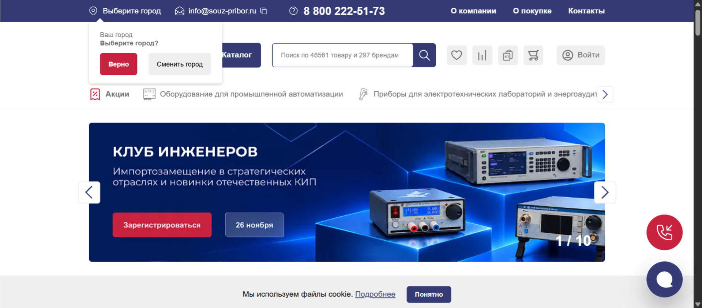
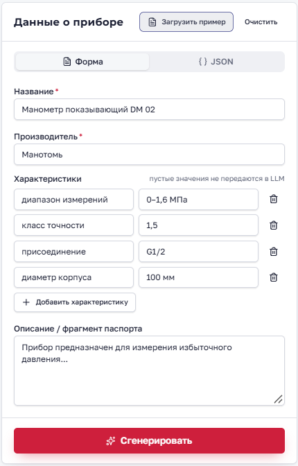
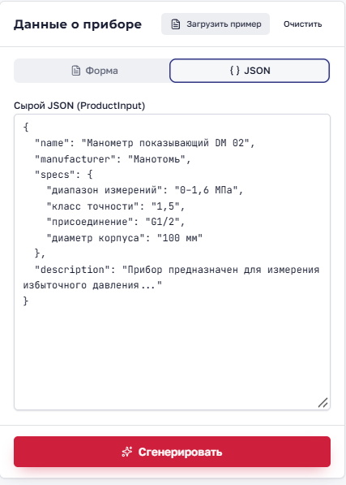
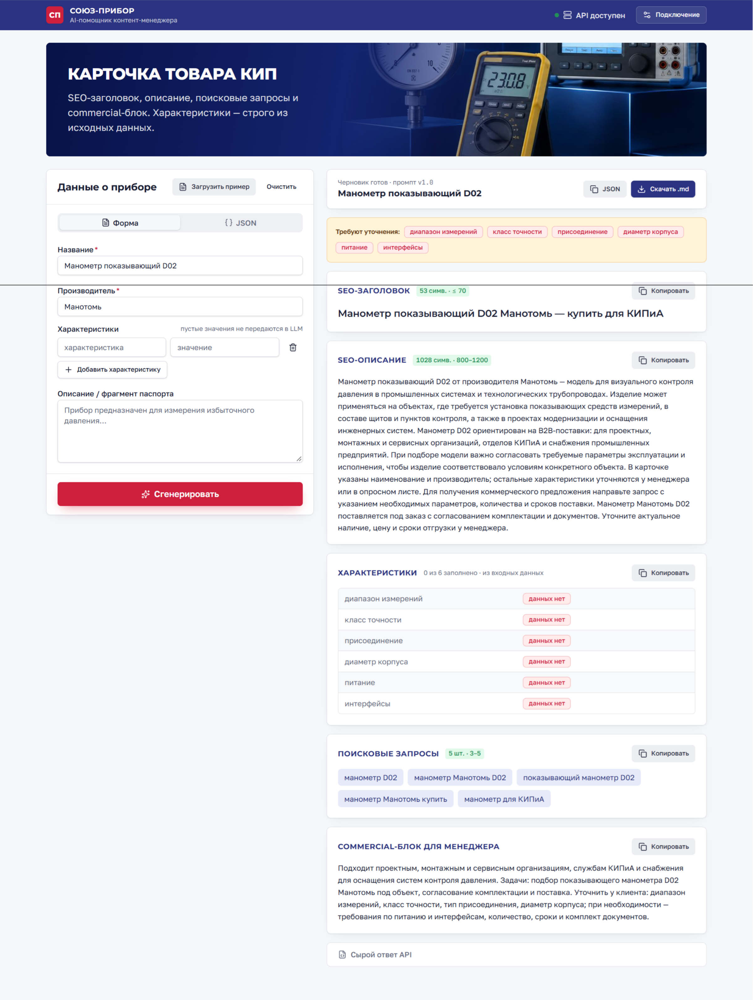
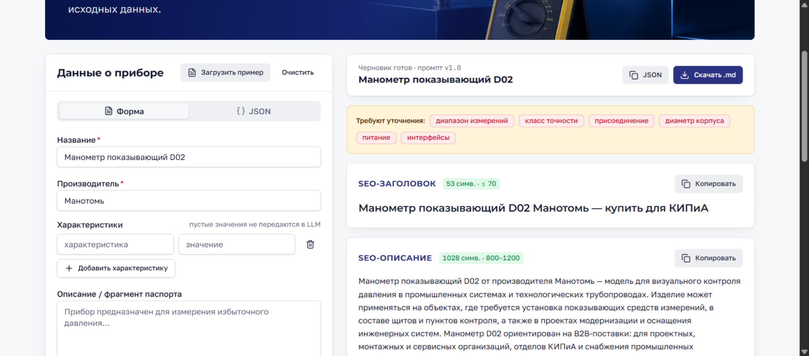

# AI-помощник карточек товаров КИП

MVP-сервис для подготовки черновиков карточек B2B-магазина контрольно-измерительных приборов: SEO-тексты через DeepSeek, **технические характеристики собираются детерминированно** из входных `specs` без участия LLM.

**Стек:** FastAPI (Python 3.12) + React/TypeScript (`client/`, TanStack Start + Vite + Tailwind).

## Демо

Витрина, для которой готовятся черновики, и интерфейс помощника: ввод формой или JSON и готовая карточка.



*Магазин КИП: каталог, для которого сервис готовит черновики карточек.*

Форма с заполненными характеристиками. Пустые значения в API не уходят.



Тот же товар можно вставить сырым JSON (`ProductInput`).



Если ожидаемых полей нет во входе, карточка всё равно собирается: в характеристиках стоит «данных нет», SEO-текст и коммерческий блок пишутся отдельно.





## Быстрый старт (Docker)

1. Скопируйте переменные окружения:
   ```sh
    cp .env.example .env
   ```
2. Укажите `DEEPSEEK_API_KEY` в `.env`.
3. Запуск:
   ```sh
    make up
    # или: docker compose up --build
   ```
4. Откройте UI: [http://localhost:5173](http://localhost:5173)

   API: [http://localhost:8000/api/health](http://localhost:8000/api/health)

Браузер обращается к бэкенду по `http://localhost:8000` (`VITE_API_BASE_URL`). CORS разрешён для `http://localhost:5173`.

### Makefile

| Команда | Описание |
|--------|----------|
| `make up` / `make down` / `make logs` | Docker Compose |
| `make health` | Проверка `/api/health` |
| `make generate` | POST `/api/generate` с `samples/product_1.json` |
| `make test` | pytest в контейнере бэкенда |
| `make test-client` | Vitest в `client/` |
| `make dev-api` | Uvicorn локально (порт 8000) |
| `make dev-web` | Vite dev-сервер (порт 5173) |

## Локальная разработка без Docker

**Backend:**

```sh
make install-api
cd backend
py -3 -m uvicorn app.main:app --reload --port 8000
```

**Frontend:**

```sh
cd client
cp .env.example .env   # при необходимости
npm install
npm run dev
```

В шапке UI можно переключить URL API. **Демо-режим** в клиенте имитирует ответ бэкенда без ключа DeepSeek.

## Примеры товаров

Файлы в [`samples/`](samples/) совпадают с кнопкой «Загрузить пример» в UI:

1. `product_1.json` — манометр DM 02 (полный набор типовых specs).
2. `product_2.json` — преобразователь ПД-И (пустое «питание» отбрасывается; часть ожидаемых полей отсутствует → в ответе «данных нет»).

Проверка через API:

```sh
make generate
# второй пример:
make generate SAMPLE=samples/product_2.json
```

## API

- `GET /api/health` → `{"status":"ok"}`
- `POST /api/generate` — тело как в `ProductInput` (`name`, `manufacturer`, `specs`, `description`).

Ошибки LLM: 401/402/429/503/504 с текстами из ТЗ в поле `detail`.

## Промпты (v1.0)

- [`backend/prompts/system_v1.md`](backend/prompts/system_v1.md) — роль контент-менеджера, запрет выдумывать характеристики, JSON-схема ответа.
- [`backend/prompts/user_template_v1.md`](backend/prompts/user_template_v1.md) — название, производитель, SPECS, описание, список полей без данных.

В ответе API поле `prompt_version`: `"v1.0"`.

## Гарантия характеристик

1. Список `characteristics` строится в [`backend/app/generator.py`](backend/app/generator.py) только из переданных `specs`.
2. Ожидаемые поля (диапазон, класс точности, присоединение, диаметр корпуса, питание, интерфейсы), которых нет во входе, получают значение **«данных нет»**.
3. LLM генерирует только `seo_title`, `seo_description`, `search_queries`, `commercial_block` (JSON mode DeepSeek).

## Переменные окружения

См. [`.env.example`](.env.example). Ключ `DEEPSEEK_API_KEY` необходим для боевой генерации. Файл `.env` в git не попадает.

## Тесты

```sh
cd backend && py -3 -m pytest
cd client && npm test
```

Тесты бэкенда не вызывают реальный DeepSeek API (mock LLM).

## Ограничения MVP

- Нет SSE-стриминга, истории запросов, batch-режима и кэша.
- Один товар на запрос, stateless.
- Зависимость от доступности DeepSeek API.
- Docker для фронта использует dev-сервер Vite (не production-сборку Nitro/Cloudflare).

## Структура репозитория

```
backend/          FastAPI, промпты, pytest
client/           React UI (прототип)
samples/          JSON-примеры
screens/          скриншоты для README
docker-compose.yml
Makefile
```
